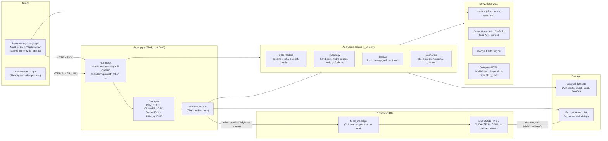
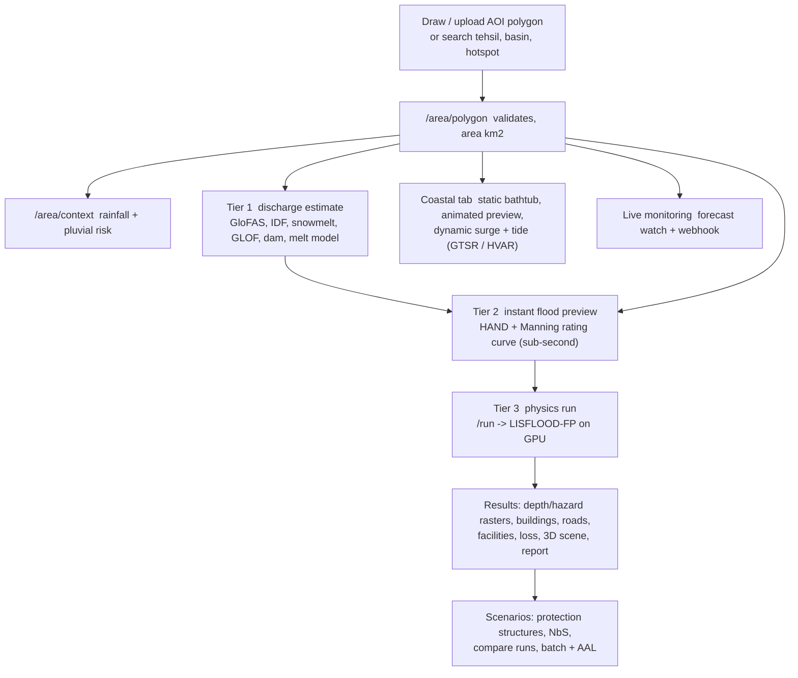
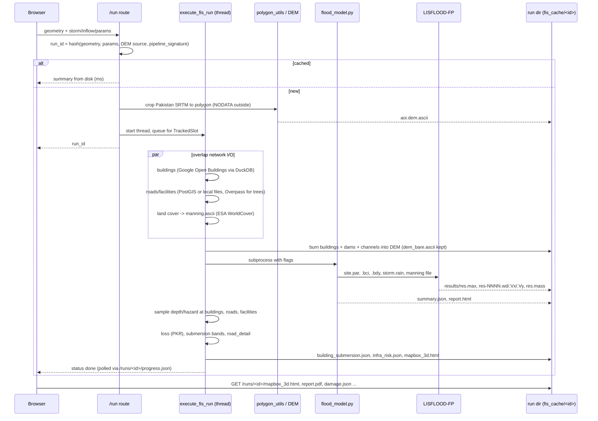
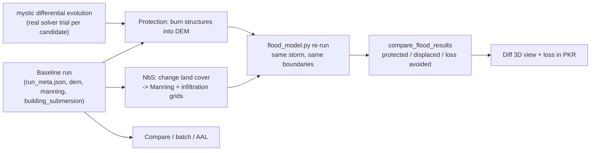
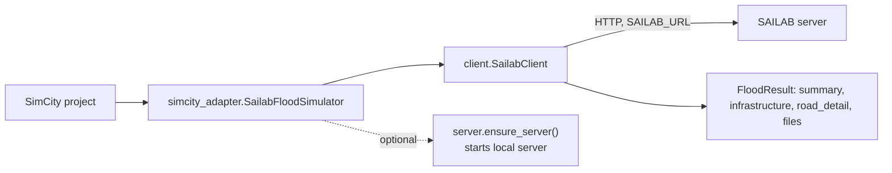

# SAILAB Architecture

**SAILAB** (Simulation & Analytics for Inundation, Loss, Assets & Built Environment) v6.1.
A Flask web app that models flood hazard and impact for Pakistan. A user draws or uploads an area; SAILAB estimates discharge, previews the flood instantly, then runs a real 2D physics model (LISFLOOD-FP on the GPU) and reports buildings, roads, facilities, loss, mitigation options and 3D views.

> Written for engineers who maintain or integrate with SAILAB. Diagrams are Mermaid (render on GitHub). Counts and file names come from the code as of 30 Oct 2026. The engineering log is `CLAUDE.md`; every constant and formula is in `DATA_SOURCES_AND_METHODS.md`.

---

## 1. System at a glance

**Design rules that shape everything**

| Rule | Consequence |
|---|---|
| One physics engine (LISFLOOD-FP via `flood_model.py`) | Every scenario (rain, river, GLOF, dam, coastal, protection, NbS) is "build inputs, run, read outputs" |
| Cache key = hash of the drawn polygon + parameters + `pipeline_signature()` | Repeat requests return in milliseconds; changing code or dam data invalidates old runs |
| Slow work is async (job id + progress JSON) | No request blocks for minutes; one solver run at a time (`TrackedSlot`) |
| Real data first, stated approximations otherwise | Each result carries its source/caveat; missing data degrades visibly (`/data-status`) |
| No auto-reload | After editing any `.py`, restart the server (`~/flood/venv/bin/python fis_app.py`) |

---

## 2. Tiered workflow (what the user sees)

Tier 1 and Tier 2 never need the solver. Tier 3 is the only place the GPU is used for normal runs. The coastal dynamic run and the scenario re-runs also call the solver.

---

## 3. Core data flow: one Tier 3 run (`POST /run`)

Progress stages (`RUN_STAGES`): `dem` -> `buildings` -> `model` -> `postprocess` -> `scene` -> `done`. The progress JSON also reports queue position and what currently holds the solver.

**Inputs to `/run`:** polygon (GeoJSON), rain mm/h + duration (or an uploaded rainfall series, or a design storm), friction fallback, infiltration (manual, AMC slider, or soil-derived), inflows (river/GLOF/dam/melt hydrograph with edge + position + width), coastal HVAR, include-buildings flag, global-DEM consent.

**Outputs:** see section 6 (run directory).

---

## 4. Solver layer

| Piece | Role |
|---|---|
| `flood_model.py` (2,494 lines) | CLI wrapper. Writes the LISFLOOD-FP input files, picks the solver, runs it, post-processes into `summary.json` and an HTML report. Also usable standalone. |
| LISFLOOD-FP 8.2 (`lisflood-fp-8.2/`) | The physics: ACC (local inertial) and DG2 solvers, CUDA and CPU builds. Built from source for the GB10 GPU. |
| `lisflood_patches/` | Patched CUDA kernels kept in git: stage (HVAR) boundary fix. Re-apply after any re-extract. |

Solver selection (`choose_solver_for_terrain`): ACC by default; DG2 for steep terrain (mean slope over 10 percent) up to 4,000,000 cells; ACC forced when a river inflow is present. Time step starts at 5 s, 1 s on steep terrain, 0.2 s with boundary inflow. Constant inflow is written as a flat QVAR because CUDA ACC has no QFIX4 case. River/GLOF inflow over NODATA cells and coastal compound cases fall back to the CPU build (`SAILAB_FORCE_CPU=1` forces CPU, `SAILAB_FORCE_CUDA=1` is test-only). `OMP_NUM_THREADS` is pinned to 1 (measured faster).

Known limits: ACC loses accuracy on extreme relief (over about 800 percent slope); single precision is rejected for high-altitude terrain; the CUDA path leaves `res.maxHaz` and some `res.mass` columns empty, which `flood_model.py` recomputes.

---

## 5. Module map (every Python file)

### 5.1 Application and engine

| File | Lines | Contains |
|---|---:|---|
| `fis_app.py` | 9,297 | Flask app, inline HTML/JS UI (`PAGE`), all routes, job registries, `execute_fis_run`, scenario runners, report builders, monitoring thread start |
| `flood_model.py` | 2,494 | Physics CLI: file writers (`write_par_file`, `write_bci_file`, `write_bdy_file`, `write_rain_file*`), solver choice, retry on CUDA cold-start, hazard/mass fixes |
| `mapbox3d_utils.py` + `mapbox3d_app.js`, `_body.html`, `_style.css` | 207 + assets | Builds the self-contained 3D flood page (GPU water shader, timeline, probe, export). All four files deploy together |
| `data_paths.py` | 82 | Single registry of external dataset paths (`SAILAB_<NAME>` env overrides); `/data-status` |
| `gui_app.py`, `watch_runs.py`, `progress_utils.py`, `pak_flood_tool.py` | | Original standalone PluviSim GUI/CLI tools the engine came from; kept, not used by `fis_app.py` except `progress_utils` patterns |
| `osm_buildings_3d.py` | 519 | Standalone "Area 3D" tool at `/osm-buildings-3d` |

### 5.2 Geometry and terrain

| File | Contains |
|---|---|
| `polygon_utils.py` | Upload loader (geojson, shp, zipped shp incl. nested folders), DEM crop with polygon mask |
| `global_dem_utils.py` | Opt-in Copernicus GLO-30 for AOIs outside Pakistan, cached in `global_dem_cache/` |
| `buildings_utils.py` | Google Open Buildings fetch (quadkeys, DuckDB), DEM burn-in of footprints, vectorised footprint/height assembly (OSM height tags) |
| `channel_utils.py` | River channel bathymetry carved into the DEM ("pseudo sub-grid channel") |
| `dams_utils.py` | Global Dam Watch dams/reservoirs burned into every run; failure scenarios (Froehlich); spillway events and outlook |

### 5.3 Vector infrastructure

| File | Contains |
|---|---|
| `pg_vector_utils.py` | SimCity PostGIS reader (roads, hospitals, schools, power, railways, airports). `isb.roads_drivable` inside Islamabad. Returns `None` on failure so files take over |
| `infra_utils.py` | `fetch_osm_infrastructure` (merges PostGIS/files/Overpass trees), risk classification by depth/hazard, building submersion bands, `road_detail` |
| `islamabad_layers_utils.py` | Six Islamabad-only categories from the smart-city GeoPackage (shelters, police, water, fuel/chemical, governance, industry) |
| `overpass_utils.py` | Shared Overpass client with retry on timeout/5xx |

### 5.4 Hydrology and discharge sources

| File | Contains |
|---|---|
| `hand_utils.py` | Tier 2: pysheds D8, HAND, Manning rating curve, inundation library, cache in `hand_cache/` |
| `rainfall_rivers_utils.py` | Open-Meteo rainfall, waterway crossing for inflow siting, GloFAS discharge |
| `rainfall_csv_utils.py` | Uploaded rain-gauge CSV to per-station series, geocoding, nearest-station pick |
| `idf_utils.py` | Pakistan IDF/ETCCDI extreme-rain cubes, tehsil search, national hotspots |
| `climate_utils.py` | CMIP6 Gumbel design storms and climate factors |
| `storm_utils.py` | Areal reduction factor, storm-centred rainfall |
| `storm_motion_lstm.py` | LSTM storm-motion nowcast (Earth Engine) |
| `pluvial_utils.py` | Flash-flood risk tier from forecast vs 20-year climatology |
| `srm_utils.py` | Degree-day snowmelt discharge (single day and multi-day) |
| `hydro_model.py` | Distributed daily snow/glacier/soil/lake model |
| `melt_hydrograph_utils.py`, `calibrate_melt_basin.py`, `validate_melt_vs_glofas.py` | Basin melt hydrograph, GloFAS check, per-basin calibration with hold-out |
| `basin_utils.py` | HydroSHEDS level-8 basin index, search, nearest, geometry |
| `soil_utils.py` | SoilGrids to USDA texture, Ksat infiltration, sediment d50 |
| `geomorphology_utils.py` | GLiM lithology, ML landslide susceptibility, valley depth/confinement |

### 5.5 Hazards: glacier, GLOF, coastal

| File | Contains |
|---|---|
| `glof_utils.py` | Popov discharge, HydroLAKES and PMD lake lookup, curated Shishper preset, landslide trigger |
| `glof_events_utils.py` | HMAGLOFDB event catalogue, Popov validation band |
| `glacier_monitoring_utils.py` | Sentinel-1 offset-tracking displacement via Earth Engine, GLIMS baseline |
| `itslive_utils.py` | No-login glacier speed from ITS_LIVE |
| `coastal_utils.py` | Water levels (Khan datum-corrected, GTSM), static bathtub, GTSR surge, wave run-up, tide+surge series |
| `coastal_layers_utils.py` | Sea mask, mangroves, susceptibility index, level library |
| `tide_utils.py` | Harmonic tide fitted to the Karachi gauge |

### 5.6 Impact, scenarios, reporting

| File | Contains |
|---|---|
| `loss_utils.py` | Building and agriculture loss in PKR (Huizinga/JRC Asia) |
| `damage_utils.py` | Land-cover damage %, Manning table, Getis-Ord hotspots |
| `sediment_utils.py` | Bed shear stress / transport capacity |
| `aal_utils.py` | Average annual loss from return-period losses |
| `nbs_utils.py` | Reforestation, wetland, grassland scenarios; before/after comparison |
| `protection_utils.py`, `protection_optimizer.py` | Dam/barrage/canal/drainage/retention structures; mystic differential-evolution search over real solver runs |
| `observed_validation_utils.py` | CSI/POD/FAR against an uploaded observed extent |
| `susceptibility_map_utils.py`, `result_report_utils.py` | Static classified map PNG; coastal/GLOF PDF summaries |
| `monitoring_utils.py` | Forecast watch, threshold logic, webhook alert |
| `cache_cleanup.py` | Dry-run-by-default old-run cleanup |
| `validate_2022_flood.py`, `validate_2022_attribution.py` | Sindh 2022 validation against UNOSAT |
| `richdem_watershed*.py` | Legacy Bahawalpur scripts, not used by the app |

---

## 6. Run directory and caches (outputs)

`fis_cache/<run_id>/`

| File | What |
|---|---|
| `aoi.dem.ascii`, `dem_bare.ascii` | Physics DEM (buildings/dams/channels burned in) and the bare terrain |
| `site.par`, `site.bci`, `site.bdy`, `storm.rain`, `manning.ascii` | LISFLOOD-FP inputs |
| `results/res.max`, `res.maxHaz`, `res.mass`, `res-NNNN.{wd,Vx,Vy,elev}` | Raw solver outputs (peak depth, hazard, mass balance, per-timestep depth and velocity) |
| `run_meta.json` | All request parameters and the AOI geometry (reused by scenarios) |
| `summary.json` | Metrics plus Python-side enrichment (buildings, loss, infra risk, version) |
| `buildings.parquet`, `building_mask.npy`, `building_submersion.json` | Footprints and per-building band/loss |
| `infra_raw.json`, `infra_risk.json` | Fetched features (with geometry) and risk classification |
| `lulc.npy`, `damage_*.json/npz`, `sediment*` | Lazily computed on first request |
| `mapbox_3d.html`, `report.html`, `report.pdf` | 3D page and reports |
| `run.log` | Full log |

| Cache | Used by |
|---|---|
| `fis_cache/` | Tier 3 runs |
| `fis_nbs_cache/`, `fis_protect_cache/` | NbS and protection scenarios |
| `fis_coastal_dyn_cache/` | Dynamic coastal runs |
| `fis_compare_reports/` | Compare/batch report PNGs and PDFs |
| `hand_cache/`, `global_dem_cache/`, `climate_cache/`, `melt_cache/`, `itslive_cache/`, `fis_aoi3d_cache/`, `fis_area3d_buildings_cache/` | Tier 2, global DEM, design storms, melt model, glacier speed, 3D helpers |
| `fis_uploads/`, `fis_imports/` | User uploads; SimCity plan imports |

---

## 7. Inputs: external data and services

### 7.1 Local datasets (paths in `data_paths.py`)

| Dataset | Used for | Required |
|---|---|---|
| Pakistan SRTM (`Pak_srtm.tif`, 13 GB, ~29 m, UTM 42N) | All terrain | **yes** |
| Google Open Buildings tiles (`global_data/buildings_pk`) | Building footprints | for buildings |
| PostGIS `simcity` (`SAILAB_PG_URL`) | Roads, facilities, rail, airports | no (files fall back) |
| Hospitals, Schools, Power, Rail, Airports, Sea ports shapefiles; HOTOSM roads GeoPackage | Same, fallback | no |
| Islamabad smart-city GeoPackage | Six extra facility categories | no |
| Global Dam Watch (`Dams data/`), spillway events CSV | Dams, reservoirs | no |
| SoilGrids (`global_data/soil_data`) | Infiltration | no |
| ERA5 t2m/tp zarr, CMIP6, IDF/IMERG cubes (`rainfall_idf`) | Melt model, design storms, IDF | no |
| HydroSHEDS basins, HydroLAKES, PMD glacier/lake inventory, HMAGLOFDB | Basins, GLOF | no |
| GTSR, GTSM levels, sea mask, mangroves, Karachi tide gauge | Coastal | no |
| GLiM, landslide susceptibility, confinement, valley depth, IceBoost, debris factor | Geomorphology, melt | no |

### 7.2 Network services

| Service | Used by | Failure behaviour |
|---|---|---|
| Mapbox (tiles, terrain DEM, geocoding, token in `.env`) | UI and 3D page | Map blank without token |
| Open-Meteo (forecast, archive, marine, flood API/GloFAS) | Rainfall, pluvial, monitoring, discharge | Panel shows error; runs unaffected |
| Overpass | Trees, waterway siting, building heights | Retries 3x, then empty |
| ESA WorldCover (S3 COG) | Manning friction, damage | Falls back to uniform friction |
| Copernicus DEM (S3) | Opt-in global AOIs | Refuses without consent flag |
| Google Earth Engine | Glacier SAR, storm nowcast | "Not available" message if credential lapses |
| NASA ITS_LIVE | Glacier speed | Retries, cached |

### 7.3 Secrets and configuration

`~/flood/.env` (never committed): `MAPBOX_TOKEN`, `SAILAB_PG_URL`, `SAILAB_ACCESS_TOKEN` (non-loopback requests need it when set), `PUBLIC_BASE_URL` (links in webhook alerts). `.env.example` holds placeholders.

---

## 8. Interfaces (route families)

| Family | Routes (examples) | Behaviour |
|---|---|---|
| Area | `/area/polygon`, `/area/upload`, `/area/context`, `/area/buildings`, `/area/geomorphology` | Synchronous JSON |
| Tier 1 sources | `/area/snowmelt-*`, `/area/melt-model*`, `/area/design-storm`, `/area/idf-*`, `/area/climate-factor`, `/area/rainfall-csv`, `/glof/*`, `/dams/*` | Sync or job |
| Tier 2 | `/area/instant-flood`, `-library`, `-mapbox3d` | Sync, cached HAND |
| Tier 3 | `POST /run`, `/runs/<id>/progress.json`, `/runs/<id>/cancel`, `/runs/<id>/<file>`, `infra.json`, `damage.json`, `sediment.json`, `*-mapbox3d`, `report.pdf`, `validate-observed`, `rebuild-scene`, `susceptibility-map.png` | Async run, file serving |
| Coastal | `/area/coastal-*`, `/coastal-dyn/<job>/mapbox3d` | Static sync; dynamic async |
| Scenarios | `/area/nbs-scenario`, `/area/nbs-recommend`, `/protect/run`, `/protect/optimize`, `/nbs|protect/<job>/mapbox3d` | Async jobs |
| Comparison | `/compare-runs*`, `/batch-report/*`, `/area/compute-aal` | Sync, PDF via WeasyPrint |
| Discovery | `/tehsils/*`, `/basins/*`, `/rainfall-hotspots` | Sync |
| Monitoring | `/monitor/watch|list|<id>|check-now` | Persistent JSON + background thread |
| Ops | `/data-status`, `/dem-source`, `/solver-status`, `/export-video`, `/import`, `/climate-jobs/<id>/progress.json` | |

**Job pattern.** Heavy requests return an id immediately. `/run` uses `RUN_STATE[run_id]` and `/runs/<id>/progress.json`; everything else uses `CLIMATE_JOBS` and `/climate-jobs/<id>/progress.json`. All solver users acquire `TrackedSlot`, so only one solver process runs at a time and `/solver-status` shows the holder.

---

## 9. Scenario and re-run flows

Scenarios reuse the baseline's own storm, friction grid and boundary conditions, so any difference is due to the intervention. The optimizer ranks by percent of building loss avoided (cell count when no buildings), penalising displaced flooding.

---

## 10. Frontend and 3D viewer

- **Page**: one inline HTML/JS string (`PAGE`) in `fis_app.py`. Left column: Mapbox map (satellite/streets, draw, search, tehsil/basin/hotspot pickers) over the 3D pane. Right column: AOI panel plus tier tabs (Tier 1, Tier 2, Tier 3, Coastal). Guarded by `tests/test_page_js_syntax.py` and a headless-Chromium smoke test.
- **3D page** (`mapbox3d_*`): self-contained HTML with payload inlined (depth/speed stacks, buildings, roads). GPU water shader, timeline with rain bars, click-to-pin probe, style swaps, PNG/MP4 export (MP4 via `/export-video` and bundled ffmpeg). Payload is downsampled above 5M elements; a warning is logged above 150 MB.
- **Reports**: `report.html` from `flood_model.py`; compare/batch/coastal/GLOF reports built in `fis_app.py`/`result_report_utils.py`, PDF via WeasyPrint.

---

## 11. Client plugin (`sailab-plugin/`)

A thin HTTP client; data and the GPU stay on the SAILAB host, which must be running. Version 0.3.0. Its own repo contract: never inside the SimCity repo. `/import` and `fis_imports/` accept a plan from SimCity.

---

## 12. Deployment, operations, testing

| Topic | Detail |
|---|---|
| Live copy | `~/flood` (venv at `~/flood/venv`), port 8000; remote access by SSH tunnel to `localhost:8000` |
| Working copy | `/mnt/external-ssd/DGX SHARED/Tasks/Reselli_AI/flood` (docs, shared files); code is newest in `~/flood` |
| Git | `github.com/Iliyan2004/Flood`, branch master, app at root, plugin in `sailab-plugin/`; commit only code/docs/tests, never data, caches or secrets |
| Restart | kill the old `fis_app.py` process, relaunch; check no run is in flight (`/solver-status`) |
| Tests | `pytest tests -m "not slow"` (fast, pure logic); slow tests run the real solver and need the data; `conftest.py` unsets `SAILAB_PG_URL` except for the PostGIS tests |
| Shared GPU | Others use the same GB10; no throttling in SAILAB. Retry logic handles the CUDA cold-start allocation error |
| Cleanup | `cache_cleanup.py` (dry run by default, `keep_runs.txt` protects runs) |

---

## 13. Extension points

| To add... | Touch |
|---|---|
| A new dataset path | `data_paths.py` (`_DEFAULTS`), then read via `data_paths.get` |
| A new infrastructure category | fetcher in `infra_utils.py` (and `pg_vector_utils.py`), add to `fetch_osm_infrastructure`, add label in `catLabels` in `fis_app.py` |
| A new discharge source | a `*_utils.py` function, a route returning a hydrograph `series`, feed `/run` inflows |
| A new scenario | build modified inputs, reuse `flood_model.py` re-run and `compare_flood_results` |
| A solver option | `flood_model.py` flag, then `write_par_file`; add a test in `tests/` |
| A plugin field | add to server JSON, extend `FloodResult`, bump version and CHANGELOG |

## 14. Known limits (read before trusting numbers)

- Pakistan-only by design; global AOIs need the opt-in Copernicus DEM and lose local layers.
- SRTM is a surface model, ~29 m; building and dam effects are conditioned into the DEM.
- Loss uses Asia-region JRC curves in 2010 EUR converted to PKR at a fixed rate; not Pakistan-calibrated.
- One Karachi tide gauge for the whole coast; no wave setup or tide-surge interaction.
- Melt model calibrates against GloFAS (itself a model), and one tested basin could not be reconciled.
- Extreme-relief basins (Karakoram) can still show unphysical depths on ACC.
- Earth Engine features need a valid credential and quota.
